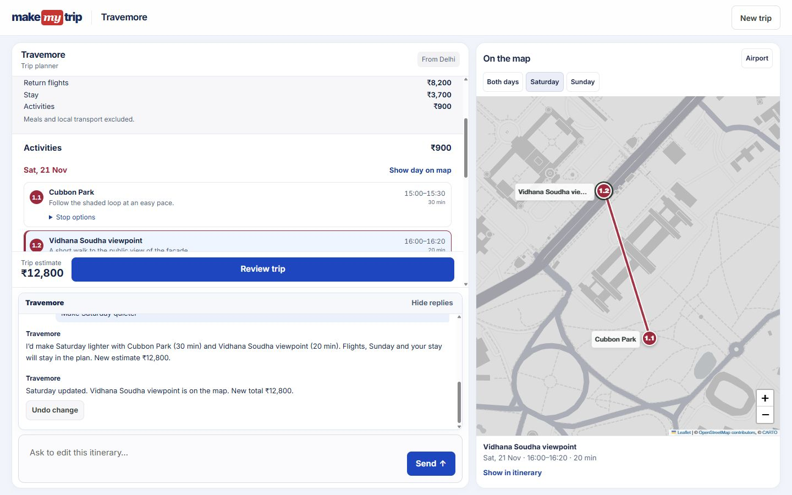
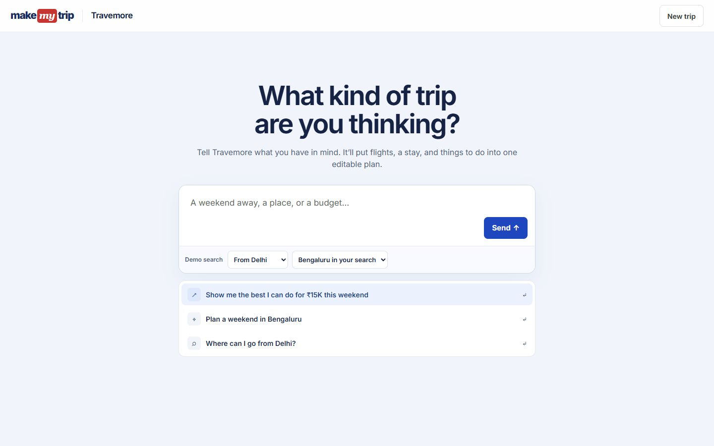

# Travemore

**A conversational weekend planner for a MakeMyTrip design prototype.**

Describe the trip you want. Travemore asks one question when the destination is unclear, then builds a plan you can edit alongside its map. Change a stop, compare a stay, or adjust the pace without starting over.

[Try the demo](#try-the-demo) · [Run locally](#run-locally) · [Explore the code](#explore-the-code) · [Deploy](#deploy)



## Try the demo

1. Open `/inspiration`. Leave the demo search context set to **From Delhi** and **Bengaluru in your search**.
2. Choose **Show me the best I can do for ₹15K this weekend**. Travemore asks whether to keep Bengaluru or compare destinations. Choose **Keep Bengaluru** to see the **₹13,400** plan.
3. In the itinerary’s composer, type **Make Saturday quieter**. The reply previews a shorter visit to Cubbon Park and a stop at Vidhana Soudha viewpoint.
4. Choose **Apply Saturday edit**. Stop **1.2** is highlighted in the itinerary and on the map, the day’s connection is redrawn, and the estimate drops to **₹12,800**. Choose **Review trip** to see the itemised estimate.

The demo also supports **Compare destinations**, day filters, stop replacement and reordering, flight and stay comparison, undo, and plan approval. On mobile, **View map** opens the same trip map, and **Show in itinerary** takes you back to the selected stop.

<details>
<summary>See the opening command bar</summary>



</details>

## Run locally

Use **Node.js 22.19 or later**, npm, and Git. From the repository root:

```sh
npm ci
npm run dev --workspace client
```

Open the URL printed by Vite and visit `/inspiration`. The demo uses browser-side fixtures and runs without an API key. Map tiles need internet access.

The optional guide APIs run in the server workspace. Start it with `PORT=4785` and `npm run dev --workspace server`. In a second terminal, set `TRAVELMORE_SERVER_URL=http://127.0.0.1:4785` before starting Vite. The server can use `CARTO_BASEMAPS_API_KEY` for map tiles and `GROQ_API_KEY` for the existing guide’s optional planning flow. The main Travemore demo uses deterministic replies.

## Explore the code

| Area | Where to look | What it does |
| --- | --- | --- |
| Planner | [Travemore.tiny.js](client/src/components/Travemore.tiny.js) | Runs the command bar, clarification, itinerary edits, comparison, and review. |
| Trip state and prices | [travemoreTrip.js](client/src/travemoreTrip.js) | Holds weekend fixtures and derives the schedule, trip total, and map points from the same selections. |
| Maps | [travemoreMap.js](client/src/travemoreMap.js) and [itineraryRoutes.js](client/src/itineraryRoutes.js) | Render Leaflet markers and day connections, share route drawing with the Jaipur guide, and sync selection with itinerary rows. |
| Original guides | [IndiaInspiration.tiny.js](client/src/components/IndiaInspiration.tiny.js) and [indiaGuides.js](client/src/indiaGuides.js) | Serve the existing Jaipur, Ahmedabad, and Hampi guides. |
| Hosting | [worker.ts](client/worker.ts) and [cloudflare.config.ts](client/cloudflare.config.ts) | Serve the frontend and optional guide APIs on Cloudflare Workers. |

The client uses **TinyBubble**, **Vite**, and **Leaflet**. The Express workspace contains the upstream server and the optional guide integrations.

## Build and verify

```sh
npm run build --workspace client
npm run typecheck
npm run cloudflare:build --workspace client
```

The main browser check follows the demo above. Also check the mobile map sheet, the **Compare destinations** branch, and the original guide at `/inspiration/jaipur`.

## Deploy

The Cloudflare Worker build includes the app and its optional server routes. To deploy, sign in with `cf` and run `npm run cloudflare:deploy` from `client/`. If you use the guide integrations, add `CARTO_BASEMAPS_API_KEY` and `GROQ_API_KEY` through Cloudflare secrets. A private `client/.dev.vars` file can be passed with `npm run cloudflare:deploy -- --secrets-file .dev.vars`.

## Scope and credits

Travemore is an independent prototype for the Razorpay × NID design exercise. Prices, inventory, and approval are simulated. The weekend flow covers Bengaluru and Jaipur from Delhi or Mumbai. Trip edits live in the current browser session, and map lines connect stops in itinerary order.

Built on [TravelMore by antocorr](https://github.com/antocorr/TravelMore). The [upstream project notes](UPSTREAM.md) describe the original app and its broader server features. Code is distributed under the [MIT license](LICENSE). The [Bengaluru photograph](https://commons.wikimedia.org/wiki/File:Vidhana_Soudha_in_daylight.jpg) is by Basavaraj M, under [CC BY-SA 4.0](https://creativecommons.org/licenses/by-sa/4.0/), cropped in the interface.
